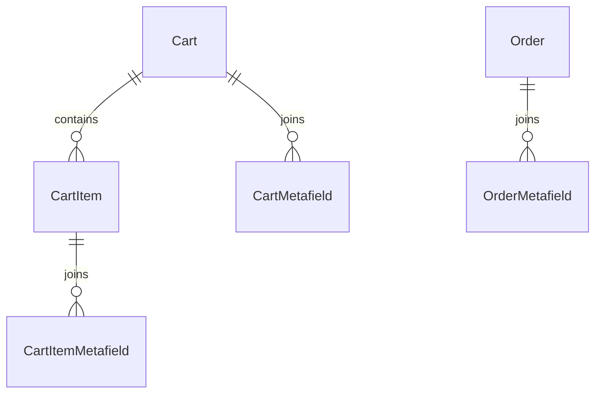
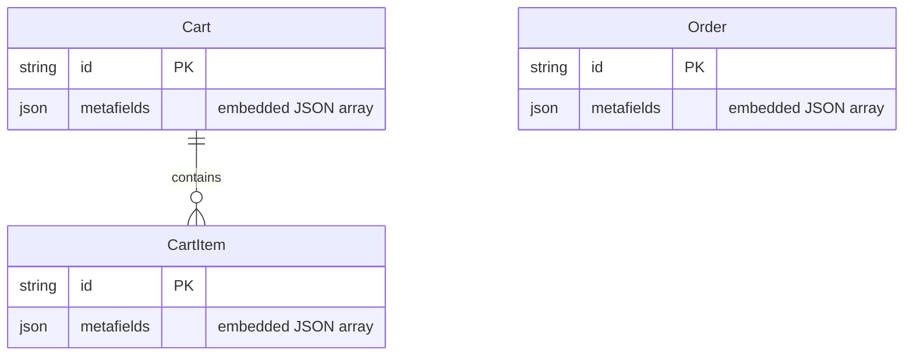

# Metafields Architecture Optimization & API Specification Guide

**Document Reference:** `document/21.metafield_change_api_details.md`  
**Target Audience:** Frontend Engineers (Web / Mobile), Backend Developers, and System Architects  
**Module:** Cart, Cart Item, Checkout & Order Metafields  
**Database Change:** Consolidating 3 relational tables (`CartMetafield`, `CartItemMetafield`, `OrderMetafield`) into native PostgreSQL `metafields Json?` columns  
**Compatibility Guarantee:** **100% Backward Compatible — Zero Frontend Breaking Changes**  

---

## 1. Executive Summary & Impact Assessment

### Will this change affect any existing functionality?
**NO.** All existing API endpoints, HTTP routes, request payloads, URL parameters, status codes, and JSON response structures will remain **100% identical**. 

The change is strictly an **internal database storage optimization**:
- **Previously:** Every cart read or update required joining 3 separate relational tables (`Cart` ➔ `CartMetafield`, `CartItem` ➔ `CartItemMetafield`, and `Order` ➔ `OrderMetafield`). This introduced unnecessary table joins, foreign key lock overhead, and N+1 query vulnerability during high concurrency.
- **Optimized Architecture:** Metafields are stored directly as native PostgreSQL `JSONB` arrays (`metafields Json? @default("[]")`) within `Cart`, `CartItem`, and `Order` records.
- **Service Layer Adapter:** The backend service layer handles all array manipulation in memory (insert, update, delete, upsert, and validation) and returns identical object structures with `id` (UUID), `namespace`, `key`, `value`, `valueType`, `createdAt`, and `updatedAt`.

### Current Database State Check:
Live verification executed against the PostgreSQL database confirmed:
- `CartMetafield` rows: **0**
- `CartItemMetafield` rows: **0**
- `OrderMetafield` rows: **0**

Because there are currently **0 rows** in these three tables, this consolidation carries **zero risk of data loss**.

---

## 2. Architectural Comparison: Before vs After

### 2.1 Entity Relationship Comparison

#### Before (3 Relational Join Tables):

* **Read Cost:** Multi-table SQL `JOIN` on every cart retrieval (`GET /cart`).
* **Write Cost:** Multiple separate SQL round-trips for adding an item with modifiers and custom metafields.

#### After (Embedded Native JSONB):

* **Read Cost:** **0 extra table joins**. Metafields are returned instantly in the primary record SELECT.
* **Write Cost:** Atomic single-row update; zero foreign key overhead.

---

## 3. Database Schema Changes

### 3.1 `prisma/schema/cart.prisma`

#### Changes to `Cart`:
```diff
 model Cart {
   id         String          @id @default(uuid())
   customerId String?
   user       User?           @relation(fields: [customerId], references: [id], onDelete: Cascade)
   guestToken String?         @unique
   status     CartStatus      @default(ACTIVE)
   currency   String          @default("INR")
+  metafields Json?           @default("[]")
   createdAt  DateTime        @default(now())
   updatedAt  DateTime        @updatedAt
 
   items      CartItem[]
-  metafields CartMetafield[]
 }
```

#### Changes to `CartItem`:
```diff
 model CartItem {
   id            String               @id @default(uuid())
   cartId        String
   cart          Cart                 @relation(fields: [cartId], references: [id], onDelete: Cascade)
   productId     String
   variantId     String?
   quantity      Int                  @default(1)
   unitPrice     Decimal              @db.Decimal(10, 2)
   regularPrice  Decimal              @db.Decimal(10, 2)
   salePrice     Decimal?             @db.Decimal(10, 2)
   offerPrice    Decimal?             @db.Decimal(10, 2)
   modifierTotal Decimal              @default(0) @db.Decimal(10, 2)
   lineTotal     Decimal              @db.Decimal(10, 2)
   configHash    String
+  metafields    Json?                @default("[]")
   createdAt     DateTime             @default(now())
   updatedAt     DateTime             @updatedAt
 
   modifiers     CartItemModifier[]
-  metafields    CartItemMetafield[]
 }
```

#### Removed Models:
```diff
- model CartMetafield { ... }
- model CartItemMetafield { ... }
```

---

### 3.2 `prisma/schema/order.prisma`

#### Changes to `Order`:
```diff
 model Order {
   id                 String             @id @default(uuid())
   orderNumber        String             @unique
   userId             String?
   user               User?              @relation(fields: [userId], references: [id], onDelete: SetNull)
   ...
   notes              String?
   internalAdminNotes String?
+  metafields         Json?              @default("[]")
   createdAt          DateTime           @default(now())
   updatedAt          DateTime           @updatedAt
 
   items              OrderItem[]
   payments           Payment[]
   statusHistory      OrderStatusHistory[]
   couponUsages       CouponUsage[]
-  metafields         OrderMetafield[]
 }
```

#### Removed Model:
```diff
- model OrderMetafield { ... }
```

---

## 4. Metafield Object Data Structure

Every metafield stored in the JSON column retains the exact same structure as the previous relational model, ensuring full consistency:

### Cart / Cart Item Metafield Object:
```typescript
interface CartMetafield {
  id: string;          // Persistent UUID (e.g., "550e8400-e29b-41d4-a716-446655440000")
  namespace: string;   // Domain namespace (e.g., "gift_options", "delivery", "customization")
  key: string;         // Unique key within namespace (e.g., "gift_wrap", "custom_note")
  value: string;       // Value serialized as string
  valueType: "STRING" | "NUMBER" | "BOOLEAN" | "JSON";
  createdAt: string;   // ISO 8601 Timestamp
  updatedAt: string;   // ISO 8601 Timestamp
}
```

### Order Metafield Object:
```typescript
interface OrderMetafield extends CartMetafield {
  description?: string | null;  // Context/note for admin or audit
  isPublic: boolean;            // true = visible to customer; false = internal admin only
}
```

---

## 5. Complete API Endpoint Specification (Frontend Contracts)

All endpoints below remain **fully operational with identical signatures**.

### 5.1 Cart Metafields Endpoints

#### 1. List Cart Metafields
* **Route:** `GET /api/v1/cart/metafields` *(or `GET /api/v1/cart/:cartId/metafields`)*
* **Auth:** Optional (`x-guest-token` header or Bearer token)
* **Response `200 OK`:**
```json
{
  "success": true,
  "message": "Cart metafields retrieved successfully",
  "data": [
    {
      "id": "e6a0d2f0-10a4-4a2e-8d5c-9c98ef2e0123",
      "namespace": "gift_options",
      "key": "gift_wrap",
      "value": "true",
      "valueType": "BOOLEAN",
      "createdAt": "2026-10-18T10:00:00.000Z",
      "updatedAt": "2026-10-18T10:00:00.000Z"
    }
  ]
}
```

#### 2. Upsert Cart Metafield
* **Route:** `POST /api/v1/cart/metafields` *(or `POST /api/v1/cart/:cartId/metafields`)*
* **Auth:** Optional
* **Request Body:**
```json
{
  "namespace": "gift_options",
  "key": "gift_wrap",
  "value": "true",
  "valueType": "BOOLEAN"
}
```
* **Behavior:** If a metafield with the same `(namespace, key)` already exists, its `value` and `valueType` are updated. Otherwise, a new metafield with a unique `id` (UUID) is created and appended.
* **Response `200 OK`:**
```json
{
  "success": true,
  "message": "Cart metafield saved successfully",
  "data": {
    "id": "e6a0d2f0-10a4-4a2e-8d5c-9c98ef2e0123",
    "namespace": "gift_options",
    "key": "gift_wrap",
    "value": "true",
    "valueType": "BOOLEAN",
    "createdAt": "2026-10-18T10:00:00.000Z",
    "updatedAt": "2026-10-18T10:00:00.000Z"
  }
}
```

#### 3. Update Cart Metafield by ID
* **Route:** `PUT /api/v1/cart/metafields/:metafieldId`
* **Request Body:**
```json
{
  "value": "false",
  "valueType": "BOOLEAN"
}
```
* **Response `200 OK`:** Returns the updated metafield object.

#### 4. Delete Cart Metafield by ID
* **Route:** `DELETE /api/v1/cart/metafields/:metafieldId`
* **Response `200 OK`:**
```json
{
  "success": true,
  "message": "Cart metafield deleted successfully"
}
```

---

### 5.2 Cart Item Metafields Endpoints

#### 1. List Cart Item Metafields
* **Route:** `GET /api/v1/cart/items/:itemId/metafields`
* **Response `200 OK`:** Returns an array of metafields for that specific item.

#### 2. Upsert Cart Item Metafield
* **Route:** `POST /api/v1/cart/items/:itemId/metafields`
* **Request Body:**
```json
{
  "namespace": "engraving",
  "key": "custom_text",
  "value": "Maison De L'Élégance 2026",
  "valueType": "STRING"
}
```
* **Response `200 OK`:** Returns the created or updated item metafield.

#### 3. Update Cart Item Metafield by ID
* **Route:** `PUT /api/v1/cart/items/:itemId/metafields/:metafieldId`
* **Request Body:**
```json
{
  "value": "Updated Text",
  "valueType": "STRING"
}
```
* **Response `200 OK`:** Returns the updated item metafield.

#### 4. Delete Cart Item Metafield by ID
* **Route:** `DELETE /api/v1/cart/items/:itemId/metafields/:metafieldId`
* **Response `200 OK`:**
```json
{
  "success": true,
  "message": "Cart item metafield deleted successfully"
}
```

---

### 5.3 Inline Add Item to Cart (`POST /api/v1/cart/items`)

When adding an item to the cart, the client can pass inline metafields in the request:

* **Route:** `POST /api/v1/cart/items`
* **Request Body:**
```json
{
  "productId": "79b384ff-12a8-4bb8-88d4-5397fc87e584",
  "variantId": "23c28587-1763-4fc9-b3a7-20eb4a2db709",
  "quantity": 1,
  "metafields": [
    {
      "namespace": "tailoring",
      "key": "hem_length",
      "value": "32 inches",
      "valueType": "STRING"
    }
  ]
}
```
* **Response `200 OK`:** The returned cart object contains the item with its embedded `metafields` array populated with assigned UUIDs and timestamps.

---

### 5.4 Order & Checkout Metafields

#### 1. Automatic Checkout Transfer (`POST /api/v1/checkout`)
During checkout execution:
- The system reads `cart.metafields`.
- System-reserved internal keys (`price`, `paymentstatus`, `status`, `total`) are filtered out.
- The remaining customer metafields are automatically copied into `order.metafields` with `isPublic: true`.

#### 2. Customer Order Details (`GET /api/v1/customer/orders/:id` & Order Confirmation)
- The customer API filters `order.metafields` where `isPublic === true`.
- Internal admin notes or private operational tags are never exposed to the client.

#### 3. Admin Order Metafield Management
* **`GET /api/v1/admin/orders/:id/metafields`:** Returns all order metafields (both public and private).
* **`POST /api/v1/admin/orders/:id/metafields`:** Upserts an order metafield (with optional `isPublic` and `description`).
* **`DELETE /api/v1/admin/orders/:id/metafields/:metafieldId`:** Deletes a metafield from the order.

---

## 6. Service Implementation Strategy

To ensure zero bugs and pure functional architecture according to `document/CODE_STRUCTURE.md`, we use pure utility functions to manage JSON metafield arrays:

```javascript
import crypto from 'crypto';

/**
 * Normalizes any existing raw JSON data into a clean array
 */
export const normalizeMetafields = (metafields) => {
  if (!metafields) return [];
  if (Array.isArray(metafields)) return metafields;
  return [];
};

/**
 * Upserts a metafield into an array by namespace + key
 */
export const upsertMetafieldInArray = (metafieldsArray, { namespace, key, value, valueType = 'STRING', description = null, isPublic = true }) => {
  const list = [...normalizeMetafields(metafieldsArray)];
  const existingIndex = list.findIndex(
    (m) => m.namespace === namespace && m.key === key
  );

  const now = new Date().toISOString();

  if (existingIndex >= 0) {
    const updated = {
      ...list[existingIndex],
      value,
      valueType,
      updatedAt: now,
    };
    if (description !== undefined) updated.description = description;
    if (isPublic !== undefined) updated.isPublic = isPublic;
    list[existingIndex] = updated;
    return { updatedList: list, metafield: updated };
  }

  const newMetafield = {
    id: crypto.randomUUID(),
    namespace,
    key,
    value,
    valueType,
    ...(description !== undefined && { description }),
    ...(isPublic !== undefined && { isPublic }),
    createdAt: now,
    updatedAt: now,
  };

  list.push(newMetafield);
  return { updatedList: list, metafield: newMetafield };
};
```

---

## 7. Performance & Concurrency Benefits

| Metric | Before (3 Relational Tables) | After (Consolidated JSONB) | Improvement |
| :--- | :--- | :--- | :--- |
| **SQL Joins on `GET /cart`** | 2 Joins (`CartMetafield`, `CartItemMetafield`) | **0 Joins** | **100% Join Reduction** |
| **SQL Inserts on `addItem`** | 3 separate `INSERT` queries | 1 Item `INSERT` + Modifiers | **~33% Fewer DB Round-Trips** |
| **Table Count in DB** | 3 extra relational tables | 0 extra tables | Cleaner Schema |
| **Cascade Delete Overhead** | Foreign Key cascade locks on item delete | Atomic row update | Faster deletes, no table lock contention |
| **Payload Consistency** | Standard JSON array | Standard JSON array | **Identical for Frontend** |

---

## 8. Summary & Next Steps

1. **Safety Confirmation:** There are **0 rows** in `CartMetafield`, `CartItemMetafield`, and `OrderMetafield`.
2. **Compatibility:** All endpoint routes, controllers, request payloads, and response structures remain **completely unchanged**.
3. **Execution Plan:**
   - Update `prisma/schema/cart.prisma` and `prisma/schema/order.prisma`.
   - Run `npx prisma db push` to synchronize PostgreSQL.
   - Update service functions in `src/services/client/cart.service.js`, `src/services/client/checkout.service.js`, `src/services/client/order.service.js`, and `src/services/admin/order.service.js`.
   - Run test suite/verification script to validate every endpoint.
