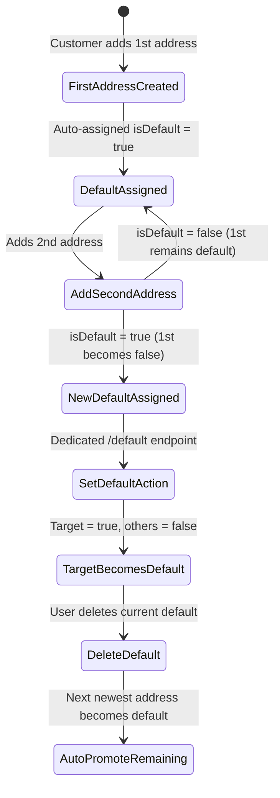

# Customer Default Address Exclusivity & Optimization Specification

**Document Reference:** `document/22.default_address_optimization.md`  
**Target Audience:** Frontend Engineers (Web / Mobile), Backend Developers & QA  
**Module:** Customer Account / Address Book / Checkout  
**Database Model:** `Address` (`prisma/schema/address.prisma`)  
**Status:** Implemented & Verified  

---

## 1. Overview & Problem Statement

In an e-commerce platform, a customer can save multiple shipping and billing addresses in their address book (e.g. Home, Office, Vacation). However, during checkout or account management, the system requires a designated **Default Address**.

### The Problems Solved:
1. **Multiple Default Addresses:** Under concurrent requests or bulk creation, without atomic transactional guarantees, a user could end up with more than one address marked as `isDefault: true`.
2. **Zero Default Addresses:** If a customer updated their only address or current default address with `isDefault: false`, they would be left with 0 default addresses, causing checkout errors or confusion.
3. **Orphaned State After Deletion:** Deleting the default address previously required careful handling to avoid leaving the customer without a default address for subsequent checkouts.
4. **Missing Dedicated Endpoint:** Frontends previously had to send a full payload or PATCH with `{ isDefault: true }` instead of having a clean, dedicated 1-click action to mark an address as default.
5. **Slow Index Scans:** The database only indexed `[userId]`, forcing full index range scans to find the default address.

---

## 2. The 5 Core Integrity Invariants

The backend now strictly enforces 5 integrity invariants across all address operations:



1. **First Address Invariant:**  
   The first address ever created by a customer is **always** set to `isDefault: true`, even if the frontend sends `isDefault: false` or omits the field.
2. **Strict Exclusivity Invariant:**  
   Whenever an address is created or updated with `isDefault: true`, all other addresses belonging to that customer are atomically set to `isDefault: false` within a single database transaction.
3. **Zero-Default Prevention Invariant:**  
   If a customer attempts to unset `isDefault: false` on their current default address:
   - If they have other addresses, the next most recently created address is automatically promoted to `isDefault: true`.
   - If it is their only address, it remains `isDefault: true`.
   *A customer with at least one saved address will NEVER have 0 default addresses.*
4. **Automatic Promotion on Deletion:**  
   When a customer deletes their default address, the system automatically finds their most recent remaining address and promotes it to `isDefault: true`.
5. **Checkout Auto-Fallback:**  
   During checkout (`POST /api/v1/checkout`), if an authenticated customer does not explicitly specify a `shippingAddressId` or inline address, the system automatically falls back to their saved default address.

---

## 3. Database Schema & Index Optimization

### `prisma/schema/address.prisma`
A composite index on `[userId, isDefault]` has been added to PostgreSQL:

```prisma
model Address {
  id          String   @id @default(uuid())
  userId      String
  user        User     @relation(fields: [userId], references: [id], onDelete: Cascade)
  firstName   String
  lastName    String
  company     String?
  address1    String
  address2    String?
  city        String
  state       String
  postalCode  String
  country     String
  phoneNumber String?
  isDefault   Boolean  @default(false)
  createdAt   DateTime @default(now())
  updatedAt   DateTime @updatedAt

  @@index([userId])
  @@index([userId, isDefault])
}
```

### Performance Benefits:
- **Instant Default Lookup:** `WHERE userId = ... AND isDefault = true` resolves in **O(log N)** index seek time.
- **Optimized Listing:** `ORDER BY isDefault DESC, createdAt DESC` leverages the composite index for sorted address book rendering.

---

## 4. Complete API Endpoint Matrix

| Method | Endpoint | Description | Auth Required |
| :--- | :--- | :--- | :--- |
| `POST` | `/api/v1/customer/addresses` | Create a new address | Yes (Bearer Token) |
| `GET` | `/api/v1/customer/addresses` | List all saved addresses (Default listed first) | Yes |
| `GET` | `/api/v1/customer/addresses/:addressId` | Get single address by ID | Yes |
| `PATCH` | `/api/v1/customer/addresses/:addressId` | Partially update address | Yes |
| `PUT` | `/api/v1/customer/addresses/:addressId` | Update address | Yes |
| **`PATCH`** | **`/api/v1/customer/addresses/:addressId/default`** | **Set address as default (1-click)** | **Yes** |
| **`PUT`** | **`/api/v1/customer/addresses/:addressId/default`** | **Idempotent PUT alias to set default** | **Yes** |
| `DELETE` | `/api/v1/customer/addresses/:addressId` | Delete address (auto-promotes remaining) | Yes |

---

## 5. Frontend Integration Guide & Examples

### 5.1 Setting an Address as Default (New Dedicated Endpoint)

When the user clicks "Make Default" on an address card in the UI:

* **Endpoint:** `PATCH /api/v1/customer/addresses/:addressId/default` (or alias `PUT`)
* **Headers:**
  ```http
  Authorization: Bearer <customer_access_token>
  ```
* **Request Body:** None required.
* **Response `200 OK`:**
```json
{
  "success": true,
  "statusCode": 200,
  "message": "Default address updated successfully",
  "data": {
    "address": {
      "id": "e9e403e6-28ef-4d77-be9e-dff4f3a25d44",
      "userId": "0bd8c799-20b2-4c5f-881e-a5baaeb4535a",
      "firstName": "Priya",
      "lastName": "Sharma",
      "company": null,
      "address1": "Flat 402, Lotus Residency",
      "address2": "Kavuri Hills, Madhapur",
      "city": "Hyderabad",
      "state": "Telangana",
      "postalCode": "500081",
      "country": "India",
      "phoneNumber": "+919876543210",
      "isDefault": true,
      "createdAt": "2026-10-18T10:00:00.000Z",
      "updatedAt": "2026-10-18T12:40:00.000Z"
    }
  }
}
```

---

### 5.2 Creating an Address (`POST /api/v1/customer/addresses`)

* **Endpoint:** `POST /api/v1/customer/addresses`
* **Request Body:**
```json
{
  "firstName": "Ananya",
  "lastName": "Rao",
  "company": "Elegance Studios",
  "address1": "12 Richmond Road",
  "address2": "Opposite Lifestyle Mall",
  "city": "Bengaluru",
  "state": "Karnataka",
  "postalCode": "560025",
  "country": "India",
  "phoneNumber": "+919123456789",
  "isDefault": true
}
```
* **Response `201 Created`:**
```json
{
  "success": true,
  "statusCode": 201,
  "message": "Address created successfully",
  "data": {
    "address": {
      "id": "74738588-0ec4-4c0d-9afb-c9df358d7884",
      "userId": "6c2d7832-b99f-44ad-96b5-1dfb62eaa41b",
      "firstName": "Ananya",
      "lastName": "Rao",
      "company": "Elegance Studios",
      "address1": "12 Richmond Road",
      "address2": "Opposite Lifestyle Mall",
      "city": "Bengaluru",
      "state": "Karnataka",
      "postalCode": "560025",
      "country": "India",
      "phoneNumber": "+919123456789",
      "isDefault": true,
      "createdAt": "2026-10-18T12:45:00.000Z",
      "updatedAt": "2026-10-18T12:45:00.000Z"
    }
  }
}
```

---

### 5.3 Fetching All Saved Addresses (`GET /api/v1/customer/addresses`)

Addresses are automatically sorted by `isDefault: desc`, ensuring the default shipping address is always the first card (`addresses[0]`):

* **Endpoint:** `GET /api/v1/customer/addresses`
* **Response `200 OK`:**
```json
{
  "success": true,
  "statusCode": 200,
  "message": "Addresses fetched successfully",
  "data": {
    "addresses": [
      {
        "id": "74738588-0ec4-4c0d-9afb-c9df358d7884",
        "firstName": "Ananya",
        "lastName": "Rao",
        "address1": "12 Richmond Road",
        "city": "Bengaluru",
        "state": "Karnataka",
        "postalCode": "560025",
        "country": "India",
        "isDefault": true
      },
      {
        "id": "e9e403e6-28ef-4d77-be9e-dff4f3a25d44",
        "firstName": "Ananya",
        "lastName": "Rao",
        "address1": "Flat 402, Lotus Residency",
        "city": "Hyderabad",
        "state": "Telangana",
        "postalCode": "500081",
        "country": "India",
        "isDefault": false
      }
    ]
  }
}
```

---

## 6. Implementation Code References

1. **Schema & Index:** [`prisma/schema/address.prisma`](file:///Users/jegannathan.m/Projects/dress-ecomm-backend/prisma/schema/address.prisma)
2. **Business Logic & Invariants:** [`src/services/client/address.service.js`](file:///Users/jegannathan.m/Projects/dress-ecomm-backend/src/services/client/address.service.js)
3. **HTTP Controller:** [`src/controllers/client/address.controller.js`](file:///Users/jegannathan.m/Projects/dress-ecomm-backend/src/controllers/client/address.controller.js)
4. **Routes:** [`src/routes/client/address.routes.js`](file:///Users/jegannathan.m/Projects/dress-ecomm-backend/src/routes/client/address.routes.js)
5. **Checkout Auto-Fallback:** [`src/services/client/checkout.service.js`](file:///Users/jegannathan.m/Projects/dress-ecomm-backend/src/services/client/checkout.service.js)
