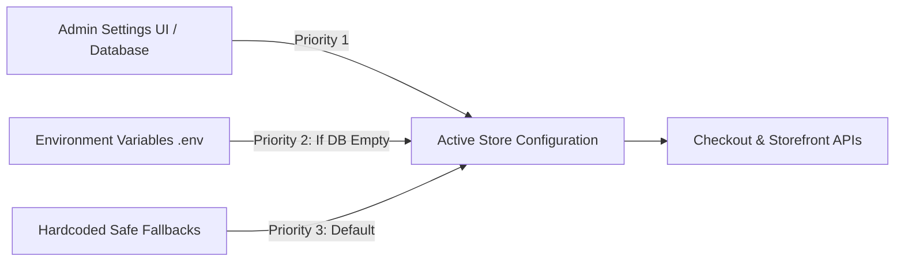
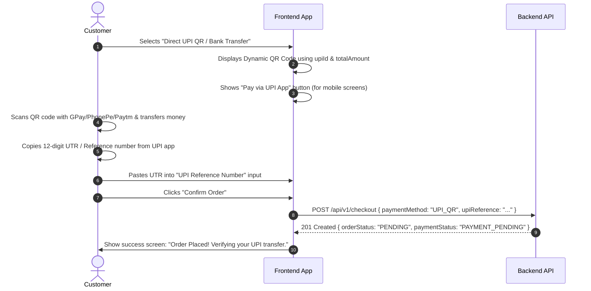

# E-Commerce Payment Integration, Dynamic Shipping & Direct UPI QR Specification

**Document Reference:** `document/23.payment_update.md`  
**Target Audience:** Frontend Developers (Web / Mobile Apps), QA Engineers, Backend Team  
**Base API URL:** `http://localhost:5000/api/v1` (Local) / `https://dress-ecomm-backend.onrender.com/api/v1` (Production)  
**Authentication:** `Authorization: Bearer <jwt_access_token>`  
**Status:** Implemented & Production-Ready  

---

## 1. Executive Summary & What Changed

To support smooth customer checkouts and flexible store operations, the backend has been upgraded with:

1. **Multi-Gateway Payment Architecture:** Support for 3 payment methods:
   - `RAZORPAY` — Automated credit/debit card, UPI, and net banking checkout via Razorpay modal.
   - `COD` — Cash on Delivery with configurable order amount ceiling (default ₹25,000 max).
   - `UPI_QR` — Direct UPI merchant bank QR code with customer UTR / UPI Reference submission and admin payment verification.
2. **Dynamic Shipping & Pricing Engine:**
   - **Default Flat Shipping Rate:** ₹150 flat fee applied to cart.
   - **Complimentary Free Shipping:** Orders with subtotal **≥ ₹2,999** automatically get ₹0 shipping.
   - **Inclusive Tax:** Zero additional tax added at checkout (`taxAmount = 0.00`, prices are inclusive).
   - **Zero Code Deployments:** Rates and thresholds are dynamically manageable via `.env` and the Admin Settings UI.
3. **Public Storefront Settings Endpoints:** Frontend can fetch live payment rules, UPI details, and shipping thresholds on page load.
4. **Enhanced Order Tracking:** Order objects now expose `upiReference`, `paymentMethod`, and `paymentStatus`.

---

## 2. Dynamic Hierarchy: How Settings Work

Store settings use a 3-tier fallback architecture:



* **Admin UI (Database):** When an admin updates flat shipping, COD limits, or UPI details via `PUT /api/v1/admin/settings`, the database immediately overrides any `.env` setting.
* **Environment Variables (`.env`):** Used during initial store launch and when no database override is set:
  - `DEFAULT_FLAT_SHIPPING_RATE=150.00`
  - `DEFAULT_FREE_SHIPPING_THRESHOLD=2999.00`
  - `DEFAULT_COD_MAX_LIMIT=25000.00`
  - `DEFAULT_UPI_ID=maison@okhdfcbank`
  - `DEFAULT_UPI_PAYEE_NAME="Maison De Élégance"`

---

## 3. Storefront API Endpoints

### 3.1 Fetch Payment Methods Configuration
Call this endpoint on checkout page load to determine which payment options to render.

* **Endpoint:** `GET /api/v1/settings/payment-methods` (or `GET /api/v1/settings`)
* **Access:** Public (No authentication required)
* **Response `200 OK`:**
```json
{
  "success": true,
  "statusCode": 200,
  "message": "Payment methods retrieved successfully",
  "data": {
    "enableRazorpay": true,
    "enableCod": true,
    "enableUpiQr": true,
    "upiId": "maison@okhdfcbank",
    "payeeName": "Maison De Élégance",
    "instructions": "Scan the QR code or tap 'Pay via UPI App', then enter your 12-digit UPI Reference / UTR Number below to confirm.",
    "codMaxLimit": 25000,
    "currency": "INR",
    "currencySymbol": "₹"
  }
}
```

---

### 3.2 Pre-Checkout Pricing Summary
Computes line item totals, validates coupon codes, and calculates shipping dynamically.

* **Endpoint:** `POST /api/v1/checkout/summary`
* **Access:** Private (`Authorization: Bearer <token>`)
* **Request Body:**
```json
{
  "couponCode": "FESTIVE20"
}
```
* **Response `200 OK`:**
```json
{
  "success": true,
  "statusCode": 200,
  "data": {
    "items": [
      {
        "productId": "prod_123",
        "title": "Silk Velvet Evening Gown",
        "unitPrice": 1800,
        "quantity": 1,
        "lineTotal": 1800
      }
    ],
    "pricing": {
      "subtotal": 1800.00,
      "discountAmount": 360.00,
      "shippingAmount": 150.00,
      "taxAmount": 0.00,
      "totalAmount": 1590.00,
      "currency": "INR",
      "freeShippingThreshold": 2999.00
    },
    "appliedCoupon": {
      "code": "FESTIVE20",
      "discountAmount": 360.00
    }
  }
}
```
> **Note on Free Shipping:** If `subtotal - discountAmount >= 2999`, then `shippingAmount` will automatically return `0.00`.

---

### 3.3 Place Order
Places the final order based on the selected payment method.

* **Endpoint:** `POST /api/v1/checkout`
* **Access:** Private (`Authorization: Bearer <token>`)

#### Option A: Razorpay (`paymentMethod: "RAZORPAY"`)
* **Request Body:**
```json
{
  "paymentMethod": "RAZORPAY",
  "shippingAddressId": "addr_uuid_here",
  "customerNotes": "Please deliver between 2 PM - 6 PM"
}
```
* **Response `201 Created`:**
```json
{
  "success": true,
  "statusCode": 201,
  "message": "Order created. Please proceed to payment.",
  "data": {
    "order": {
      "id": "ord_uuid",
      "orderNumber": "ORD-20261019-8F21",
      "totalAmount": 1590.00,
      "paymentMethod": "RAZORPAY",
      "paymentStatus": "PAYMENT_PENDING",
      "orderStatus": "PENDING"
    },
    "paymentDetails": {
      "razorpayOrderId": "order_EKf3b65q8A0kZ1",
      "amount": 159000,
      "currency": "INR",
      "keyId": "rzp_test_your_key_id"
    }
  }
}
```
* **Frontend Action:** Open the Razorpay Checkout modal using `paymentDetails.razorpayOrderId` and `paymentDetails.keyId`. On payment success, call `POST /api/v1/payments/verify`.

---

#### Option B: Cash on Delivery (`paymentMethod: "COD"`)
* **Request Body:**
```json
{
  "paymentMethod": "COD",
  "shippingAddressId": "addr_uuid_here",
  "customerNotes": ""
}
```
* **Constraint:** Customer phone number must be present (either in profile or shipping address). Total order amount must not exceed `codMaxLimit` (default ₹25,000).
* **Response `201 Created`:**
```json
{
  "success": true,
  "statusCode": 201,
  "message": "Your Cash on Delivery order has been successfully placed.",
  "data": {
    "order": {
      "id": "ord_uuid",
      "orderNumber": "ORD-20261019-9C44",
      "totalAmount": 1590.00,
      "paymentMethod": "COD",
      "paymentStatus": "PAYMENT_PENDING",
      "orderStatus": "PROCESSING"
    }
  }
}
```

---

#### Option C: Direct UPI QR Code (`paymentMethod: "UPI_QR"`)
* **Request Body:**
```json
{
  "paymentMethod": "UPI_QR",
  "shippingAddressId": "addr_uuid_here",
  "upiReference": "429182749102",
  "customerNotes": "Paid via Google Pay"
}
```
* **Field Validation:** `upiReference` is **mandatory** (min 6 characters, alphanumeric).
* **Response `201 Created`:**
```json
{
  "success": true,
  "statusCode": 201,
  "message": "Your UPI payment reference has been recorded. Your order is pending verification by our team.",
  "data": {
    "order": {
      "id": "ord_uuid",
      "orderNumber": "ORD-20261019-5D88",
      "totalAmount": 1590.00,
      "paymentMethod": "UPI_QR",
      "upiReference": "429182749102",
      "paymentStatus": "PAYMENT_PENDING",
      "orderStatus": "PENDING"
    }
  }
}
```

---

## 4. Frontend Integration Guide for UPI QR

### 4.1 Generating Dynamic QR Code & Deep Link
The frontend should generate the UPI Intent URI using standard National Payments Corporation of India (NPCI) format:

```javascript
const generateUpiUri = ({ upiId, payeeName, amount, orderRef }) => {
  const encodedName = encodeURIComponent(payeeName);
  const note = encodeURIComponent(`Order ${orderRef || 'Payment'}`);
  return `upi://pay?pa=${upiId}&pn=${encodedName}&am=${amount.toFixed(2)}&cu=INR&tn=${note}`;
};
```

### 4.2 Recommended Checkout UI Component Flow



### 4.3 Validation Checklist for Frontend Developers
1. **COD Max Limit Enforcement:** If `pricing.totalAmount > data.codMaxLimit`, disable the `COD` radio button and display:  
   *“Cash on Delivery is only available for orders up to ₹25,000. Please choose UPI or Online Payment.”*
2. **UPI Reference Field:** Only render the `upiReference` text input when `paymentMethod === 'UPI_QR'`. Enforce at least 6 characters before enabling the submit button.
3. **Free Shipping Progress Banner:** Display a progress bar on the cart page:  
   *“Add ₹{2999 - subtotal} more to enjoy Free White-Glove Delivery!”*

---

## 5. Admin Settings Configuration Endpoint

Administrators can dynamically reconfigure payment gateways, UPI details, and shipping rates directly from the Admin Panel.

* **Endpoint:** `PUT /api/v1/admin/settings`
* **Access:** Admin Only (`Authorization: Bearer <admin_token>`)
* **Request Body:**
```json
{
  "flatShippingRate": 150.00,
  "freeShippingThreshold": 2999.00,
  "paymentMethods": {
    "enableRazorpay": true,
    "enableCod": true,
    "enableUpiQr": true,
    "upiId": "maison@okhdfcbank",
    "payeeName": "Maison De Élégance",
    "instructions": "Scan the QR code or tap 'Pay via UPI App', then enter your 12-digit UPI Reference / UTR Number below to confirm.",
    "codMaxLimit": 25000.00
  }
}
```

---

## 6. Error Codes Reference

| Error Code | HTTP Status | Description | Action Required by Frontend |
| :--- | :--- | :--- | :--- |
| `UPI_REFERENCE_REQUIRED` | `400 Bad Request` | `upiReference` was omitted or less than 6 chars when `paymentMethod: "UPI_QR"`. | Prompt user to input their 12-digit UPI transaction UTR. |
| `COD_AMOUNT_EXCEEDED` | `400 Bad Request` | Order amount exceeds `codMaxLimit` (₹25,000). | Advise customer to choose Razorpay or UPI QR. |
| `PHONE_REQUIRED_FOR_COD` | `400 Bad Request` | Customer has no phone number on file. | Prompt customer to enter phone number before placing COD order. |
| `PAYMENT_METHOD_DISABLED`| `400 Bad Request` | Chosen payment method is toggled off in store settings. | Refresh settings and disable the greyed-out payment option. |
| `AUTH_RATE_LIMIT_EXCEEDED`| `429 Too Many Req`| IP exceeded 20 auth or contact attempts in 15 mins. | Display cooldown message asking customer to wait 15 minutes. |
