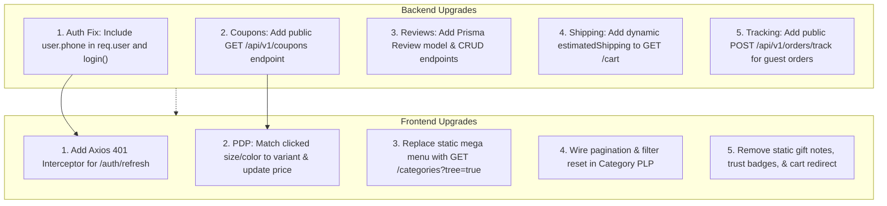
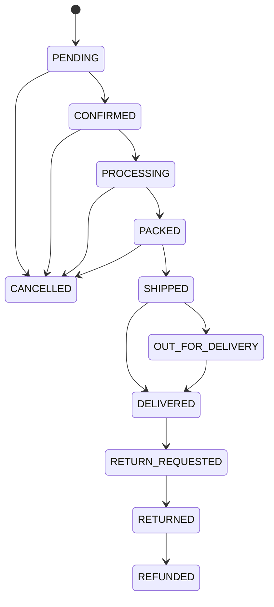
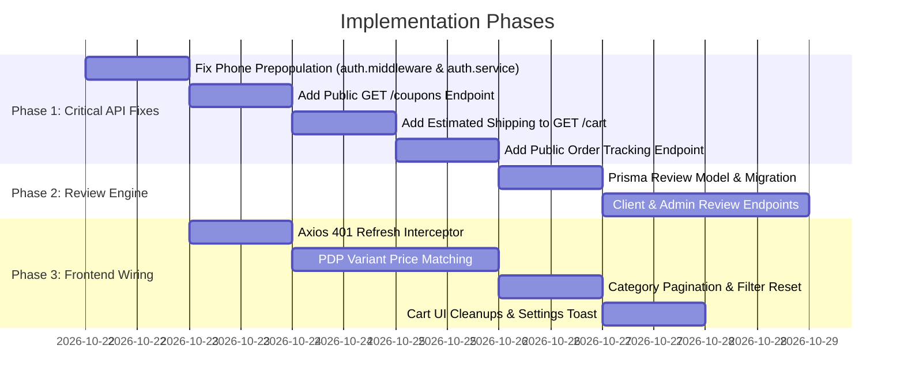

# Production UI Bugs: Backend Analysis & Dynamic Architecture Plan

**Document Reference:** `document/25.UI_bugs_backend_analysis_plan.md`  
**Source Bugs Reference:** `document/24.UI_bugs.md`  
**Frontend Codebase Path:** `D:\Projects\ecommerce_project`  
**Backend Codebase Path:** `D:\Projects\dress-ecomm-backend`  
**Target Audience:** Full-Stack Developers, Frontend Team, Backend Team, QA Engineers  
**Status:** Architectural Plan & Codebase Assessment Complete  

---

## 1. Executive Summary

A comprehensive line-by-line audit of the 24 production UI issues listed in `document/24.UI_bugs.md` was conducted against the active backend codebase (`dress-ecomm-backend`).

### Key Takeaways:
1. **The Core Backend Engine is Sound & Fully Dynamic:**
   * **Inventory Management** is fully operational: stock is validated, atomically decremented on order placement, logged in the audit ledger, and restored upon cancellation.
   * **Variant Pricing Architecture** already supports variant-specific prices, regular/sale pricing, and color/size attributes in the API responses.
   * **Admin Analytics & Dashboards** dynamically compute real-time sales volume, status distributions, and revenue charts with in-memory caching.
   * **Category Navigation** is fully hierarchical with recursive tree building (`GET /api/v1/categories?tree=true`).

2. **Identified Backend Gaps / Fixes Needed:**
   * **Phone Number Prepopulation Bug:** `auth.middleware.js` and `auth.service.js` omitted the `phone` field from `req.user` and the login response, leaving `user.phone` as `undefined` in the client.
   * **Missing Public Coupon Listing API:** The client only had `POST /coupons/validate`, forcing the frontend to hardcode two promo codes.
   * **Missing Product Review System:** No Prisma model or endpoints currently exist for customer reviews.
   * **Missing Cart Estimated Shipping:** `GET /cart` returned `shipping: null`, causing the frontend cart to show ₹0.
   * **Optional Public Order Tracking:** Order tracking currently requires customer JWT login; an unauthenticated tracking endpoint is needed for guest checkouts.

3. **Frontend Wiring Issues:**
   * Missing Axios 401 response interceptor for token refresh (causing automatic logout after 15 minutes).
   * PDP variant selection state not updating active prices when size/color options are clicked.
   * Missing toast notifications on settings save.
   * Hardcoded static category lists and marketing badges needing removal.

---

## 2. Complete Master Matrix of Issues

| # | Bug / Observation from `24.UI_bugs.md` | Primary Responsibility | Root Cause & Codebase Assessment |
|---|---|---|---|
| **1 & 15** | `product review...` / `customer review showing in products page - api not there` | **Backend Gap** | No `Review` model in Prisma. Product only has `rating` and `reviewCount` counters. Needs review schema, client submission/read endpoints, and admin moderation. |
| **2** | `remove collection from admin` | **Frontend UI** | Backend collections API (`/api/v1/admin/collections`) is fully functional. This is a navigation cleanup: remove or hide the "Collections" link in the admin sidebar. |
| **3** | `logout issue in 15 min - refresh api not called` | **Frontend Interceptor** | `JWT_ACCESS_EXPIRES_IN` is set to `15m`. Backend `POST /api/v1/auth/refresh` exists and works. Frontend lacks an Axios 401 interceptor to automatically call refresh. |
| **4** | `admin/discounts after deleting it's not reflecting` | **Backend / Frontend** | In `coupon.service.js`, if a coupon has order history (`usages > 0`), it is soft-deactivated (`isActive: false`) to safeguard invoice history. Default query returns all. Frontend must invalidate query cache and show "Inactive" status. |
| **5** | `Save Store Configuration & Payment Settings after saving popup not coming` | **Frontend UI** | API `PUT /api/v1/admin/settings` returns `200 OK` with `{ message: 'Store settings updated successfully' }`. Frontend form is missing `toast.success()`. |
| **6** | `in product admin panel - what is star need to check` | **Confirmed (Backend)** | The star toggles **`isFeatured`** (`true`/`false`) via `PATCH /api/v1/admin/products/:id/status`. Featured products appear on homepage showcases. |
| **7** | `admin - in orders tab need to add more details` | **Frontend UI** | Backend `GET /api/v1/admin/orders/:id` already returns full details: addresses, customer contact, variant attributes, tracking numbers, timeline, and payments. Frontend table/modal needs to render them. |
| **8** | `admin - analytics, dashboard fully need to check` | **Confirmed (Backend)** | Fully dynamic. `analytics.service.js` calculates live KPIs, time-series revenue charts, status breakdown, and top-sellers with 60-second caching. |
| **9, 10, 27** | `mega menu / home page / remove static categories` | **Frontend UI** | Backend `GET /api/v1/categories?tree=true` is dynamic. Frontend previously hardcoded categories ("Women's Couture", "Evening Gowns", etc.) instead of mapping over API response. |
| **11** | `Checks: Need to check inventory working or not` | **Confirmed (Backend)** | **Fully working:** Atomic stock deduction on order placement (`checkout.service.js`), stock restoration on cancellation (`order.service.js`), and transaction ledger logs. |
| **13** | `product - size guide in static` | **Architecture** | No size guide model exists in database. Size guides are currently static on the frontend. Can be made dynamic via Category schema or `StoreConfig.policiesJson`. |
| **14** | `pricing not working properly based on variant (size/color)` | **Frontend UI State** | Backend `GET /api/v1/products/:slug` returns all variants with variant-specific prices and attributes. Frontend PDP fails to match user clicks to active variant state. |
| **16** | `promocode - only showing two values` | **Backend Gap** | Backend only provides `POST /coupons/validate`. There is no public `GET /api/v1/coupons` endpoint to list active promotions, forcing frontend to hardcode two sample codes. |
| **17** | `checkout - phone number not prepopulating` | **Backend Bug** | `auth.middleware.js` omitted `phone: true` from `req.user`, and `auth.service.js` omitted `phone` from login response. |
| **18** | `delivery change coming as 0` | **Config & Logic** | Free shipping threshold is set to ₹2,999 (luxury orders above this get ₹0 shipping). Also, `GET /cart` returned `shipping: null`. |
| **19** | `order status in admin panel` | **Confirmed (Backend)** | Backend enforces a strict state machine (`PENDING -> CONFIRMED -> PROCESSING -> PACKED -> SHIPPED -> OUT_FOR_DELIVERY -> DELIVERED`). Illegal transitions throw 400. Frontend must restrict dropdown options to valid next steps. |
| **20** | `addtocart redirecting to cart page` | **Frontend UI** | Frontend button click handler has an explicit `navigate('/cart')` call. Should be replaced with opening a cart drawer or toast. |
| **21 & 22** | `remove gift note & guarantee badges in cart` | **Frontend UI** | Static UI components hardcoded in the frontend Cart page. |
| **23** | `production email setup reminder` | **Operational** | Nodemailer transporter is ready in `email.service.js`. Requires production SMTP environment variables once domain is live. |
| **24** | `orders - track shipment for user need to fix` | **Frontend / Backend** | Authenticated tracking works. Missing an unauthenticated endpoint (`POST /orders/track`) for guest users. |
| **25 & 26** | `categories page pagination & sidebar reset` | **Frontend UI** | API already returns pagination metadata (`totalPages`, `hasNextPage`) and supports `minPrice`, `maxPrice`, `search`, `sort`. Frontend needs to bind pagination and add filter reset logic. |

---

## 3. Backend Architecture Changes & Action Plan



---

### 3.1 Item 17: Fix Phone Prepopulation at Checkout

#### Root Cause Analysis:
In `src/middlewares/auth.middleware.js`:
```javascript
// Lines 44-53
const user = await prisma.user.findUnique({
  where: { id: decoded.sub },
  select: {
    id: true,
    email: true,
    name: true,
    role: true,
    permissions: true,
    createdById: true,
    isActive: true,
    // phone: true IS MISSING HERE!
  },
});
```
In `src/services/auth.service.js`:
```javascript
// Lines 131-136
return {
  user: {
    id: user.id,
    name: user.name,
    email: user.email,
    role: user.role,
    // phone IS MISSING HERE!
  },
  accessToken,
  refreshToken: rawRefreshToken,
};
```

#### File Changes Required:
1. **`src/middlewares/auth.middleware.js`**: Add `phone: true` to the Prisma select statement.
2. **`src/services/auth.service.js`**: Add `phone: user.phone` to the returned user object in `login()`.

---

### 3.2 Item 16: Dynamic Public Coupons API

#### Current Problem:
`src/routes/client/coupon.routes.js` only provides `POST /validate`. The storefront frontend has no way to query active promo codes, resulting in hardcoded values.

#### Solution:
1. **Route:** `GET /api/v1/coupons` (Public/Customer)
2. **Service Logic (`src/services/client/coupon.service.js`):**
```javascript
export const getActivePublicCouponsService = async () => {
  const now = new Date();
  const coupons = await prisma.coupon.findMany({
    where: {
      isActive: true,
      OR: [{ startDate: null }, { startDate: { lte: now } }],
      OR: [{ endDate: null }, { endDate: { gte: now } }],
    },
    select: {
      id: true,
      code: true,
      description: true,
      discountType: true,
      discountValue: true,
      minOrderAmount: true,
      maxDiscountAmount: true,
      endDate: true,
    },
    orderBy: { createdAt: 'desc' },
  });

  return coupons.filter((c) => !c.usageLimit || c.usedCount < c.usageLimit);
};
```
3. **Mount in `src/routes/client/coupon.routes.js`**:
   `router.get('/', listPublicCoupons);`

---

### 3.3 Items 1 & 15: Product Reviews Architecture

#### Current Problem:
`Product` has `rating` and `reviewCount` fields, but no `Review` model exists in `prisma/schema`.

#### Solution:
1. **Database Schema (`prisma/schema/catalog.prisma`):**
```prisma
model Review {
  id                 String   @id @default(uuid())
  productId          String
  product            Product  @relation(fields: [productId], references: [id], onDelete: Cascade)
  userId             String?
  user               User?    @relation(fields: [userId], references: [id], onDelete: SetNull)
  customerName       String
  customerEmail      String?
  rating             Int      // 1 to 5 stars
  title              String?
  comment            String
  isVerifiedPurchase Boolean  @default(false)
  isApproved         Boolean  @default(true) // Auto-approve or moderation toggle
  createdAt          DateTime @default(now())
  updatedAt          DateTime @updatedAt

  @@index([productId])
  @@index([userId])
  @@index([isApproved])
}
```
2. **Client Endpoints:**
   * `GET /api/v1/products/:id/reviews` — Paginated reviews, rating distribution (e.g. 5★: 80%, 4★: 15%), sorted by newest/highest rating.
   * `POST /api/v1/products/:id/reviews` — Submit review. Automatically checks if customer purchased the item to set `isVerifiedPurchase: true`.
3. **Rating Recalculation Trigger:**
   * Whenever a review is added/updated/deleted, compute `averageRating = sum(rating) / count` and atomically update `Product.rating` and `Product.reviewCount`.
4. **Admin Endpoints:**
   * `GET /api/v1/admin/reviews` — Paginated review moderation table.
   * `PATCH /api/v1/admin/reviews/:id/status` — Approve or hide review.
   * `DELETE /api/v1/admin/reviews/:id` — Delete spam/inappropriate review.

---

### 3.4 Item 18: Delivery Charges & Shipping Clarification

#### Current Behavior:
* In `StoreConfig` (seeded in `settings.service.js`):
  * `flatShippingRate = 150`
  * `freeShippingThreshold = 2999`
* For any luxury order where subtotal $\ge$ ₹2,999, shipping is **₹0** ("Complimentary White-Glove Shipping").
* In `src/services/client/cart.service.js`, `getCartDetails()` returns `shipping: null`.
* In `src/services/client/checkout.service.js`, `computeCheckoutPricing()` correctly charges ₹150 if subtotal < ₹2,999.

#### Solution:
1. In `src/services/client/cart.service.js`:
   * Fetch `storeConfig`.
   * Compute estimated shipping:
     ```javascript
     const freeShippingThreshold = Number(storeConfig.freeShippingThreshold) || 2999;
     const flatShippingRate = Number(storeConfig.flatShippingRate) || 150;
     const estimatedShipping = subtotal >= freeShippingThreshold ? 0 : flatShippingRate;
     ```
   * Replace `shipping: null` with `shipping: estimatedShipping` and expose `freeShippingThreshold`.
2. In the Admin Panel (`/admin/settings`):
   * If the client wants flat shipping on **all** orders without free delivery, set `freeShippingThreshold = 0` or a high amount (e.g. ₹50,000).

---

### 3.5 Item 24: Public / Guest Shipment Tracking

#### Current Behavior:
`GET /api/v1/orders/:orderNumber` requires `Authorization: Bearer <token>`. Guests or users tracking from email links cannot track orders without logging in.

#### Solution:
Add an unauthenticated tracking endpoint in `src/routes/client/order.routes.js`:
* **Endpoint:** `POST /api/v1/orders/track`
* **Access:** Public (Rate-limited via IP limiter)
* **Payload:**
  ```json
  {
    "orderNumber": "ORD-20261012-7A3B",
    "emailOrPhone": "customer@example.com"
  }
  ```
* **Validation:** Case-insensitive match on `orderNumber` AND (`customerEmail` OR `customerPhone`).
* **Response:**
  ```json
  {
    "orderNumber": "ORD-20261012-7A3B",
    "status": "SHIPPED",
    "courierPartner": "BlueDart Express",
    "trackingNumber": "BLUEDART-8839201",
    "estimatedDelivery": "2026-10-25T18:00:00.000Z",
    "statusTimeline": [
      { "status": "CONFIRMED", "createdAt": "2026-10-21T10:00:00.000Z" },
      { "status": "PACKED", "createdAt": "2026-10-21T14:30:00.000Z" },
      { "status": "SHIPPED", "createdAt": "2026-10-22T09:15:00.000Z" }
    ]
  }
  ```

---

## 4. Backend Verifications (Confirmed Operational)

### 4.1 Item 11: Inventory Stock Decrement Verification
* **Location:** `src/services/client/checkout.service.js` (Lines 396–465)
* **Stock Decrement Logic:**
  ```javascript
  // Variant Stock Validation & Decrement
  if (item.variantId) {
    const variant = await tx.productVariant.findUnique({
      where: { id: item.variantId },
      select: { id: true, stockQuantity: true, name: true }
    });
    if (!variant || variant.stockQuantity < item.quantity) {
      throw new AppError('Insufficient stock', HTTP_STATUS.CONFLICT, 'INSUFFICIENT_STOCK');
    }
    await tx.productVariant.update({
      where: { id: item.variantId },
      data: { stockQuantity: variant.stockQuantity - item.quantity }
    });
    await tx.inventoryTransaction.create({
      data: {
        variantId: item.variantId,
        productId: item.productId,
        type: 'SALE',
        quantityChange: -item.quantity,
        previousStock: variant.stockQuantity,
        newStock: variant.stockQuantity - item.quantity,
        referenceId: orderNumber
      }
    });
  }
  ```
* **Cancellation Restoral Logic:** `src/services/admin/order.service.js` (Lines 430–470) restores stock quantity and creates an `InventoryTransaction` of type `'RETURN'`.

---

### 4.2 Item 6: What is the Star in Product Admin Panel?
* **Identifier:** `isFeatured` (Boolean)
* **Endpoint:** `PATCH /api/v1/admin/products/:id/status`
* **Payload:** `{ "isFeatured": true }` or `{ "isFeatured": false }`
* **Effect:** Highlights the garment on the storefront home page and featured curation carousels (`GET /products?isFeatured=true`).

---

### 4.3 Item 19: Order Status State Machine in Admin Panel
The backend prevents invalid fulfillment jumps via a formal state machine in `src/services/admin/order.service.js`:



* Jumping from `PENDING` directly to `DELIVERED` will return `400 Bad Request` (`ILLEGAL_STATUS_TRANSITION`) unless the administrator holds the `SUPER_ADMIN` role.
* The frontend order status dropdown should only render allowed next transitions for the order's current status.

---

## 5. Frontend Action Items (`ecommerce_project`)

### 5.1 Token Refresh & 15-Minute Auto-Logout (Item 3)
Add an Axios response interceptor in the API client module:
```javascript
api.interceptors.response.use(
  (response) => response,
  async (error) => {
    const originalRequest = error.config;
    if (error.response?.status === 401 && !originalRequest._retry) {
      originalRequest._retry = true;
      try {
        const res = await axios.post('/api/v1/auth/refresh', {}, { withCredentials: true });
        const newAccessToken = res.data.data.accessToken;
        setAuthToken(newAccessToken);
        originalRequest.headers['Authorization'] = `Bearer ${newAccessToken}`;
        return api(originalRequest);
      } catch (refreshErr) {
        logoutUser();
        return Promise.reject(refreshErr);
      }
    }
    return Promise.reject(error);
  }
);
```

---

### 5.2 Dynamic Variant Price Switching on PDP (Item 14)
When attributes (size or color) are clicked on the product detail page:
1. Match the selected attributes against `product.variants`:
   ```javascript
   const selectedVariant = product.variants.find((v) =>
     v.attributes.every((attr) => selectedAttributes[attr.attributeSlug] === attr.valueSlug)
   );
   ```
2. If `selectedVariant` exists:
   * Display `selectedVariant.price.currentPrice`.
   * Display `selectedVariant.stockQuantity` and out-of-stock badge if $\le 0$.
   * Pass `variantId: selectedVariant.id` when calling `POST /api/v1/cart/items`.
3. If no variant is selected, fallback to base `product.price`.

---

### 5.3 Discount Deletion Reflection (Item 4)
In `admin/discounts`:
* When `DELETE /api/v1/admin/discounts/:id` is called:
  * Invalidate query cache via `queryClient.invalidateQueries(['discounts'])` or remove the item from local state.
  * If the response message indicates that the coupon was deactivated due to historical order usages, update its status badge to **Inactive** rather than removing it from the view.

---

### 5.4 Settings Toast Notification (Item 5)
In the store configuration and payment settings form:
```javascript
const handleSaveSettings = async (formData) => {
  try {
    const res = await api.put('/api/v1/admin/settings', formData);
    toast.success(res.data.message || 'Settings saved successfully');
  } catch (error) {
    toast.error(error.response?.data?.message || 'Failed to update settings');
  }
};
```

---

### 5.5 Category PLP Pagination & Filter Reset (Items 25 & 26)
* Bind pagination buttons to URL query params (`?page=2`).
* Compute pages from `response.pagination.totalPages`.
* Add a **Reset Filters** button in the sidebar that clears `minPrice`, `maxPrice`, `search`, and `sort` back to defaults.

---

### 5.6 Cart Page Cleanups (Items 20, 21, 22)
* **Item 20:** In `handleAddToCart()`, remove `navigate('/cart')` and trigger a slide-out cart drawer instead.
* **Item 21:** Remove the "Add Personalized Gift Note / Packaging" UI block from `Cart.jsx`.
* **Item 22:** Remove static trust badges ("Guaranteed Authentic & Handcrafted", "Express Insured White-Glove Shipping", "Complimentary 7-Day Boutique Returns") from `Cart.jsx`.

---

## 6. Production Deployment & Domain Setup (Item 23)

When moving to the production domain:

1. **CORS & Cookie Whitelisting (`.env`):**
   ```env
   CLIENT_URL="https://your-custom-domain.com"
   NODE_ENV="production"
   ```
2. **SMTP Email Credentials (`.env`):**
   ```env
   SMTP_HOST="smtp.mailgun.org" # or Sendgrid / AWS SES / Google Workspace
   SMTP_PORT=587
   SMTP_USER="concierge@your-custom-domain.com"
   SMTP_PASS="your-strong-smtp-password"
   SUPPORT_EMAIL="concierge@your-custom-domain.com"
   ```
3. **Razorpay Production Credentials (`.env`):**
   ```env
   RAZORPAY_KEY_ID="rzp_live_..."
   RAZORPAY_KEY_SECRET="your_live_secret"
   RAZORPAY_WEBHOOK_SECRET="your_webhook_secret"
   ```

---

## 7. Execution Roadmap


